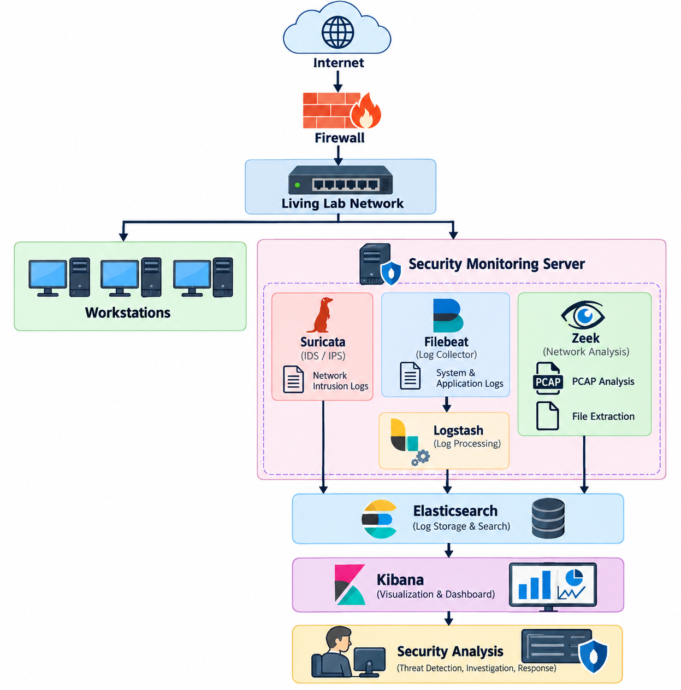
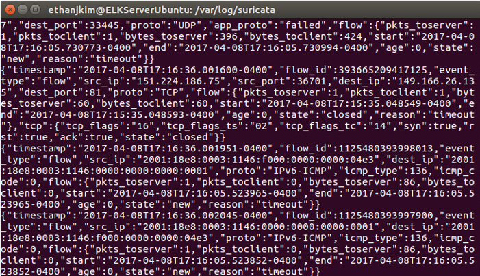
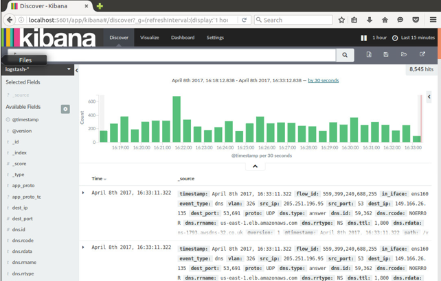
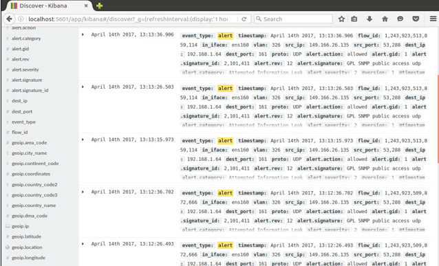
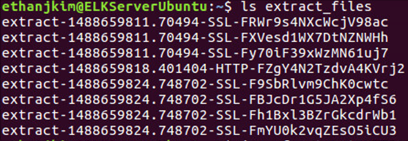

# Network Intrusion Detection & SIEM Lab

## Overview

This project was completed as part of the IUPUI Living Lab,
where I designed and implemented an open-source network security
monitoring solution.

The goal was to deploy an Intrusion Detection System (IDS) and
centralized logging platform capable of monitoring network
traffic, generating security alerts, analyzing network activity,
and supporting packet and file analysis.

The solution integrated Suricata with the ELK Stack
(Elasticsearch, Logstash, and Kibana), Filebeat, and
Zeek (formerly Bro IDS).

> **Original Project:** IUPUI Living Lab — Spring 2017  
> This repository is a portfolio reconstruction of the original
> project. Product names and versions reflect the technologies
> used at the time.

---

## Project Objectives

- Deploy an open-source network Intrusion Detection System
- Monitor network traffic and generate security alerts
- Centralize IDS logs using the ELK Stack
- Visualize security events through Kibana
- Capture and analyze network traffic
- Perform file extraction from captured traffic
- Document configuration and troubleshooting procedures

---

## Technologies Used

| Technology | Purpose |
|---|---|
| Suricata | Network intrusion detection |
| Elasticsearch | Security event storage and search |
| Logstash | Log processing and transformation |
| Kibana | Security event visualization |
| Filebeat | Suricata log forwarding |
| Zeek (formerly Bro) | Network analysis and file extraction |
| Ubuntu Linux | Security monitoring server |
| VMware vSphere | Virtual infrastructure |
| tcpdump | Packet capture |

---

## Architecture

The security monitoring environment was designed to capture network traffic from the Living Lab network and centralize security events for analysis.

Suricata monitored network traffic and generated IDS events, while Filebeat forwarded the logs to Logstash for processing. The processed events were stored in Elasticsearch and visualized through Kibana.

Zeek (formerly Bro) provided additional network analysis capabilities, including packet capture analysis and file extraction.

---

## Implementation

### 1. Network Intrusion Detection with Suricata

Suricata was deployed on the Ubuntu security monitoring server to inspect network traffic and generate IDS events.

The configuration enabled monitoring for protocols including HTTP, SSH, TLS, and SMTP. Suricata generated structured event data through `eve.json`, providing information about network flows, alerts, source and destination addresses, ports, and protocol activity.

### 2. Centralized Logging with the ELK Stack

Suricata logs were forwarded through Filebeat to Logstash, where the JSON events were processed before being stored in Elasticsearch.

The logging pipeline followed this flow:

`Suricata → Filebeat → Logstash → Elasticsearch → Kibana`

Kibana provided a centralized interface for searching and visualizing network security events.

### 3. Security Alert Analysis

Kibana was configured to filter Suricata events and isolate IDS alerts for investigation.

Security events could be reviewed using fields such as:

- Source and destination IP addresses
- Source and destination ports
- Event type
- Alert category
- Alert signature
- Protocol information

### 4. Network Analysis and File Extraction with Zeek

Zeek (formerly Bro) was deployed as an additional network analysis platform.

Network traffic was captured using `tcpdump` and saved as PCAP data for offline analysis. Zeek processed the captured traffic and generated connection and protocol logs.

File extraction was also tested by transferring a file through the monitored network, capturing the traffic, and extracting the transferred file from the PCAP.

